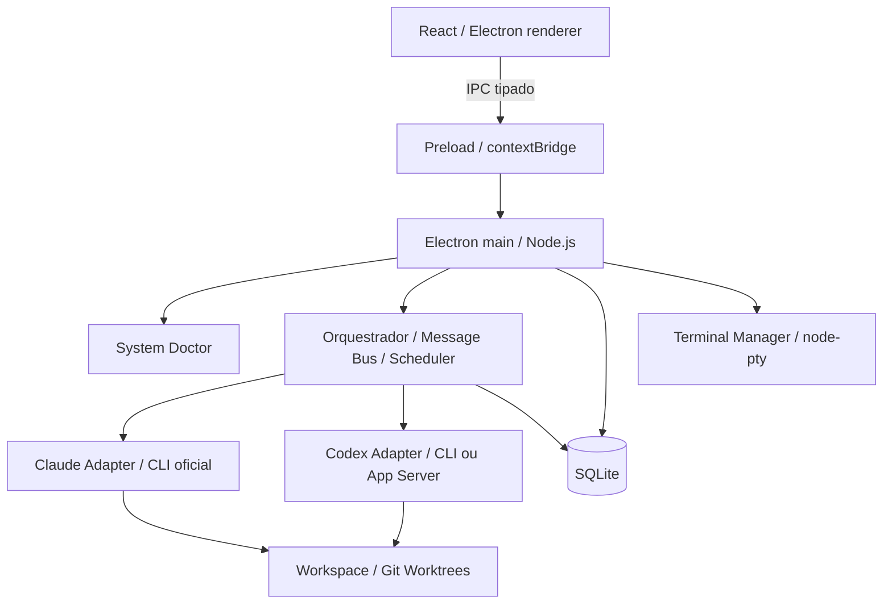

# Arquitetura



## Stack
Electron, React, TypeScript, Vite, Tailwind CSS, shadcn/ui, Zustand, Node.js integrado, node-pty, xterm.js, SQLite, Zod, Monaco Editor, Git Worktree, Electron Builder, Vitest e Playwright. IPC local é preferível a WebSocket no MVP. Não é necessário Docker, Redis ou PostgreSQL.

## Camadas
Renderer: interface, estado visual e consulta via ponte tipada. Preload: API mínima com validação. Main: processos, arquivos, Git, banco, segurança e diagnóstico. Adapters: encapsulam capacidades e protocolos oficiais. Orquestrador: regras determinísticas, não requer outro modelo. Persistência: SQLite com migrações. Terminal: PTY e eventos, com backpressure e limites de memória.

## Estrutura proposta
```text
src/
  main/
    index.ts
    ipc/
    agents/AgentAdapter.ts
    agents/ClaudeCodeAdapter.ts
    agents/CodexAdapter.ts
    orchestrator/Orchestrator.ts
    orchestrator/MessageBus.ts
    orchestrator/TaskScheduler.ts
    orchestrator/LoopGuard.ts
    system/SystemDoctor.ts
    system/DependencyChecker.ts
    system/DependencyInstaller.ts
    system/AuthChecker.ts
    system/PlatformDetector.ts
    terminal/TerminalManager.ts
    workspace/WorkspaceManager.ts
    workspace/GitManager.ts
    workspace/WorktreeManager.ts
    security/PermissionManager.ts
    security/CommandValidator.ts
    database/migrations/
    database/repositories/
  preload/index.ts
  renderer/
    components/{agents,chat,terminal,editor,git,system-doctor}/
    pages/{Onboarding,Dashboard,Workspace,Sessions,Settings}.tsx
    hooks/
    stores/
  shared/{types,schemas,constants}/
tests/{unit,integration,e2e}/
resources/
scripts/
docs/
package.json
electron-builder.yml
AGENTS.md
CLAUDE.md
README.md
```

A árvore acima é uma proposta, não código implementado.
