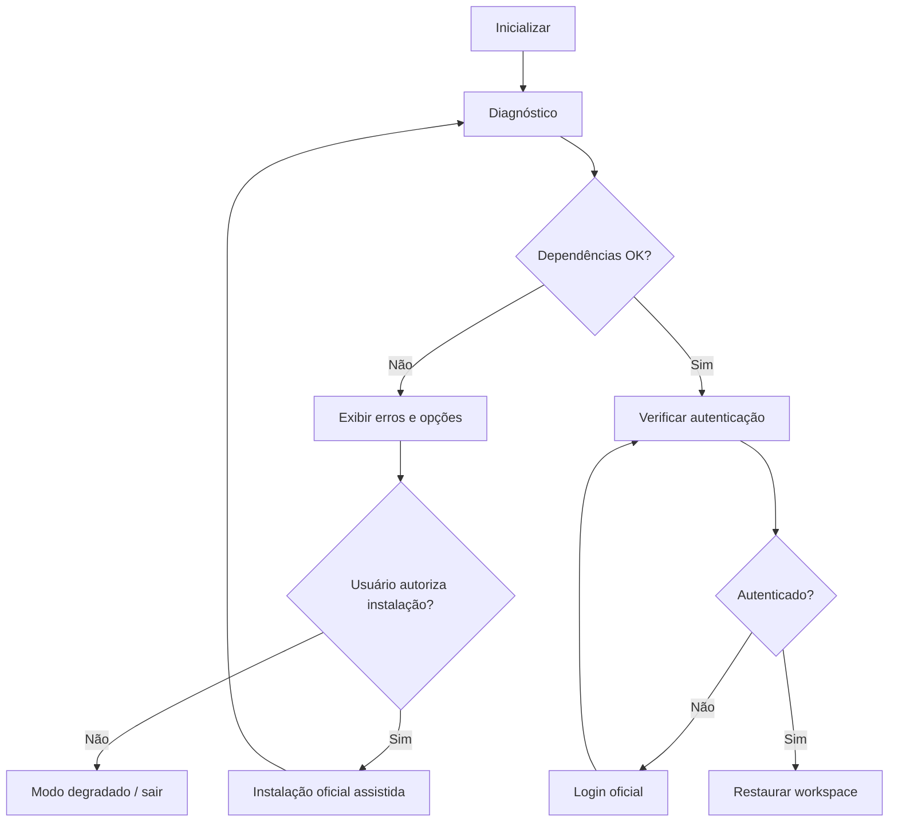

# System Doctor

Executar toda vez que o DevFusion iniciar, antes de abrir agentes. Reexecutar após instalação, mudança de PATH, login ou solicitação manual. Primeira execução apresenta onboarding; diagnóstico posterior exibe problemas relevantes e permite modo degradado.

| Item | Verificação | Necessidade |
|---|---|---|
| SO e arquitetura | APIs do sistema, compatibilidade | Obrigatória |
| Git | git --version | Colaboração Git |
| Claude Code | claude --version | Agente Claude |
| Codex | codex --version | Agente Codex |
| Contas | Fluxos oficiais de status/login conforme versão | Por agente |
| Internet | Conectividade com provedor, timeout | Agentes online |
| Workspace | Leitura/escrita e caminho válido | Obrigatória |
| Disco | Espaço disponível | Obrigatória |
| Node.js/npm externos | node --version / npm --version | Conforme método de instalação |
| Python / Docker | Verificação sob demanda | Projeto específico |

O runtime Node do Electron não substitui necessariamente o Node externo requerido por ferramentas. Detectar executáveis via PATH e locais de instalação oficiais conhecidos; não fazer varredura indiscriminada. Validar caminho e versão mínima documentada/testada, não inventar versões.

## Fluxo

## Implementação
Cada check devolve id, estado (ok, ausente, incompatível, não autenticado, desconhecido, opcional, erro), versão, caminho, detalhe sanitizado e ação sugerida. Diferenciar timeout de instalação ausente. Rodar checks independentes em paralelo limitado; não travar interface. Status desconhecido nunca equivale a login confirmado. Não ler tokens nem senhas.

Instalador: mostrar origem oficial, comando ou procedimento, permissões e versão antes de pedir autorização. Não executar indiscriminadamente scripts remotos ou elevar privilégios. Se instalação automática não for segura/disponível, abrir instrução oficial. Revalidar após instalação; atualizar PATH da sessão ou orientar reinício se necessário. Nunca instalar sem consentimento.

## Aceitação
Testar ambiente limpo, só um agente, ambos instalados, sessão deslogada, PATH incorreto, versões antigas, ausência de conexão, disco insuficiente, permissões negadas, cancelamento e instalação malsucedida. O aplicativo deve continuar acessível para configurar dependências.
