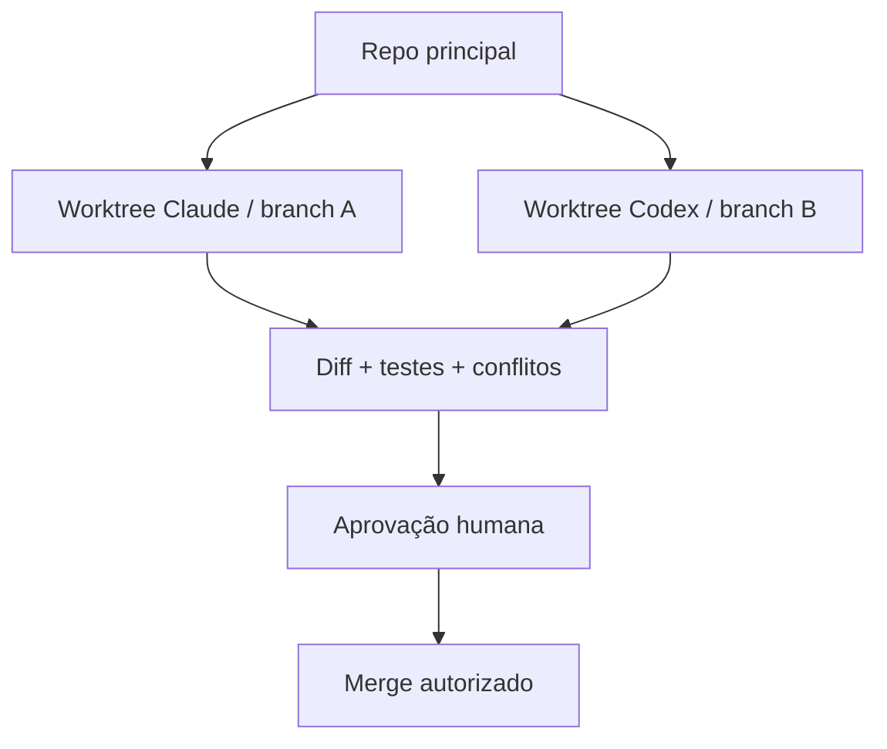

# Workspace, Git e banco

Workspace selecionado pelo usuário; validar raiz, permissões e estado Git. Não inicializar repositório nem descartar mudanças sem consentimento. Em execução sequencial, usar um diretório autorizado, com checkpoints. Em paralelo, criar branch e worktree por tarefa, a partir de referência explícita. Alterações não commitadas na raiz não são automaticamente copiadas: informar usuário e escolher snapshot autorizado.

Relatar arquivos modificados, conflitos e resultados de testes. Mostrar diff; permitir aprovar, rejeitar, reverter e integrar sem apagar trabalho não relacionado. Git worktree reduz colisões mas não é sandbox de segurança. Usar caminhos reais e verificar links simbólicos. Remoção de worktree somente após confirmação se houver alterações.

## SQLite
| Tabela | Campos essenciais |
|---|---|
| workspaces | id, path, name, created_at |
| agents | id, provider, config_json |
| sessions | id, workspace_id, agent_id, provider_session_id, state |
| messages | id, session_id, task_id, sender, recipient, content, created_at |
| tasks | id, workspace_id, parent_id, status, assignee, criteria_json |
| executions | id, task_id, agent_id, state, exit_code, started_at, ended_at |
| approvals | id, task_id, scope, status, decided_at |
| dependencies | id, version, status, checked_at |
| git_snapshots | id, task_id, branch, commit, worktree_path |
| settings | key, value_json |
| audit_logs | id, action, target, timestamp, metadata_json |

Usar migrações versionadas, foreign keys, transações e índices em mensagens/sessões/tarefas. Persistir só dados necessários; permitir limpeza/exportação do histórico. Não gravar tokens, senhas ou segredos em logs. Sessão restaurada não implica processo ainda vivo; conferir e reconstruir estado quando suportado.
